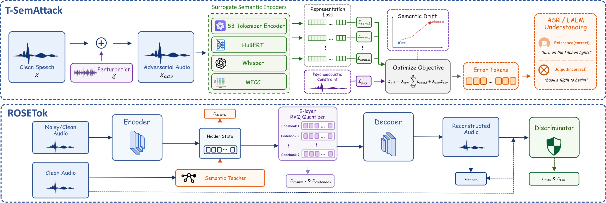

<div align="center">

# T-SemAttack & ROSETok

### Speech Tokenizers are Vulnerable<br>Transferable Semantic Attack and Robust Tokenizer

**NeurIPS 2026**

[](TBD)
[](https://wxzyd123.github.io/t-semattack/)
[](https://huggingface.co/wxzyd123/ROSETok)


</div>

---

Small waveform perturbations can cause large shifts in speech representations. This repository accompanies our study of speech tokenizer vulnerability and provides the **T-SemAttack** semantic attack and **ROSETok** robust speech tokenizer.

| Component | Description |
| --- | --- |
| **T-SemAttack** | A transferable attack that jointly perturbs S3 Tokenizer, HuBERT, Whisper, and MFCC representations with psychoacoustic constraints. |
| **ROSETok-Base** | A 16 kHz tokenizer pretrained with Gaussian-noise augmentation and semantic distillation from a Whisper teacher. |
| **ROSETok-AAF** | ROSETok-Base with attack-aware fine-tuning on T-SemAttack examples. |

<p align="center">
  
</p>

## Quick links

[Installation](#installation) · [Run T-SemAttack](#run-t-semattack) · [Use ROSETok](#use-rosetok) · [Checkpoints](#checkpoints) · [Citation](#citation)

## Installation

Use Python 3.10 and a CUDA-enabled GPU for the attack pipeline. ROSETok inference also supports CPU execution.

```bash
git clone https://github.com/wxzyd123/T-SemAttack.git
cd T-SemAttack

conda create -n t_semattack python=3.10 -y
conda activate t_semattack
python -m pip install -r requirements.txt
```

The dependencies use PyTorch 2.8.0, TorchAudio 2.8.0, and TorchVision 0.23.0. For a specific CUDA build, install the matching trio using the official installation commands before installing the remaining dependencies. [PyTorch installation options](https://pytorch.org/get-started/previous-versions/#v280)

Install FFmpeg for audio decoding if it is unavailable in your environment.

```bash
# Ubuntu
sudo apt install ffmpeg

# macOS
brew install ffmpeg
```

## Run T-SemAttack

### 1. Prepare the surrogate encoders

| Surrogate | Model |
| --- | --- |
| S3 Tokenizer | CosyVoice v1, `speech_tokenizer_v1.onnx` |
| HuBERT | `facebook/hubert-large-ll60k` |
| Whisper | `openai/whisper-large-v3` |
| MFCC | Computed directly from the waveform |

Download the S3 checkpoint.

```bash
hf download FunAudioLLM/CosyVoice-300M speech_tokenizer_v1.onnx --local-dir checkpoints/cosyvoice
```

Set `tokenizer_path` in `build_tokenizer_encoders()` in `attack_semantic.py`.

```python
tokenizer_path = "checkpoints/cosyvoice/speech_tokenizer_v1.onnx"
```

HuBERT and Whisper download automatically on first use. The attack optimizes through all four surrogate representations, so GPU memory requirements include the full ensemble.

### 2. Configure the example and run

Edit the settings in the `__main__` block of `attack_semantic.py`.

```python
audio_path = "examples/0_train_117.wav"
output_path = "examples/0_train_117_semantic.wav"
epsilon = 8 / 255
max_items = 500
device = torch.device("cuda")
verbose = False
```

```bash
python attack_semantic.py
```

Use mono input audio. The script resamples speech to 16 kHz for the surrogate encoders, saves the perturbed waveform at the input sample rate, and reports its final signal-to-noise ratio (SNR).

| Setting | Meaning | Example default |
| --- | --- | --- |
| `epsilon` | Maximum absolute waveform perturbation | `8 / 255` |
| `max_items` | Optimization iterations | `500` |
| `device` | Device for the surrogate ensemble | `cuda` |
| `verbose` | Print intermediate losses | `False` |

## Use ROSETok

Run the following example from the repository root. It downloads a checkpoint, loads the tokenizer parameters, converts the input to mono 16 kHz audio, and saves a reconstruction.

```python
import torch
import torchaudio
import soundfile as sf
import yaml
from huggingface_hub import hf_hub_download

from rosetok import ROSETok

device = torch.device("cuda" if torch.cuda.is_available() else "cpu")

with open("config/rosetok_16khz.yml", encoding="utf-8") as f:
    config = yaml.safe_load(f)
model_config = {
    key.removeprefix("ROSETok."): value
    for key, value in config.items()
    if key.startswith("ROSETok.")
}
model = ROSETok(**model_config)

checkpoint_path = hf_hub_download(
    repo_id="wxzyd123/ROSETok",
    filename="rosetok_base.pth",  # Use rosetok_aaf.pth for ROSETok-AAF.
)
checkpoint = torch.load(
    checkpoint_path, map_location="cpu", weights_only=True, mmap=True
)
# The released checkpoints also contain the training-time semantic teacher.
codec_state = {
    key: value
    for key, value in checkpoint["state_dict"].items()
    if key.startswith(("encoder.", "quantizer.", "decoder."))
}
model.load_state_dict(codec_state, strict=True)
model = model.to(device).eval()

audio, sample_rate = sf.read(
    "examples/0_train_117.wav", dtype="float32", always_2d=True
)
wave = torch.from_numpy(audio.mean(axis=1)).unsqueeze(0)
wave = torchaudio.functional.resample(wave, sample_rate, 16000).to(device)

with torch.inference_mode():
    result = model(wave, sample_rate=16000)

sf.write("reconstructed.wav", result["audio"][0, 0].cpu().numpy(), 16000)
print("Discrete codes", result["codes"].shape)
print("Semantic features", result["encoded"].shape)
```

Both checkpoints include a `state_dict` and training metadata. Their `semantic_encoder.*` tensors belong to the training-time teacher. The example selects the encoder, quantizer, and decoder and loads these parameters with `strict=True`.

ROSETok accepts tensors with shape `(T,)`, `(B, T)`, or `(B, 1, T)`.

| Output | Contents |
| --- | --- |
| `audio` | Reconstructed mono waveform |
| `encoded` | Continuous encoder features before quantization |
| `z` | Quantized continuous features |
| `codes` | Discrete indices from the residual codebooks |
| `latents` | Projected quantizer latents |
| `codec/commitment_loss`, `codec/codebook_loss` | Quantization losses |

The 16 kHz configuration uses a 320-sample hop, 1280-dimensional encoder features, and 9 residual codebooks with 1024 entries each.

The decoder's stride-5 padding can make reconstruction up to 8 samples shorter than the input (0.5 ms at 16 kHz). For sample-aligned comparisons, trim the reference to the returned audio length.

## Checkpoints

| Model | Download | Training |
| --- | --- | --- |
| ROSETok-Base | [rosetok_base.pth](https://huggingface.co/wxzyd123/ROSETok/resolve/main/rosetok_base.pth) | Noisy pretraining and semantic distillation |
| ROSETok-AAF | [rosetok_aaf.pth](https://huggingface.co/wxzyd123/ROSETok/resolve/main/rosetok_aaf.pth) | Attack-aware fine-tuning |

```bash
hf download wxzyd123/ROSETok rosetok_base.pth rosetok_aaf.pth --local-dir checkpoints/rosetok
```

## Repository structure

```text
T-SemAttack/
├── attack_semantic.py          # Semantic attack example
├── rosetok.py                  # ROSETok inference model
├── whisper_teacher.py         # Semantic distillation teacher
├── masker.py                  # Psychoacoustic masking loss
├── config/rosetok_16khz.yml     # Released model configuration
├── modules/                   # Encoder, decoder, RVQ, and loss modules
├── examples/                  # Clean and adversarial speech examples
└── assest/workflow.png         # Method overview
```


## Acknowledgments

The tokenizer builds on DAC and AudioTools. The attack uses S3 Tokenizer from CosyVoice, HuBERT, and Whisper. We thank their authors for making these resources available. [DAC](https://github.com/descriptinc/descript-audio-codec) · [AudioTools](https://github.com/descriptinc/audiotools) · [S3 Tokenizer](https://github.com/xingchensong/S3Tokenizer) · [HuBERT](https://huggingface.co/facebook/hubert-large-ll60k) · [Whisper](https://huggingface.co/openai/whisper-large-v3)

## Research use

This project supports research on speech tokenizer robustness and adversarial evaluation. Use the code and checkpoints for authorized experiments in accordance with applicable laws and platform policies.
